# Manual de uso — OCCB CRM

Sistema de gestión escolar: alumnos, apoderados, admisión, agenda y
comunicaciones de un colegio, en español (conmutable a inglés con ES/EN).

> Video del recorrido completo (37 s): [`video/recorrido.mp4`](video/recorrido.mp4)

## 1. Entrar al sistema

Abre el frontal y accede con tu correo y clave. La sesión vive solo en
memoria: al recargar la página hay que entrar de nuevo. Si intentas abrir una
pantalla protegida sin sesión, el sistema te lleva a acceso y luego te devuelve
a tu destino.

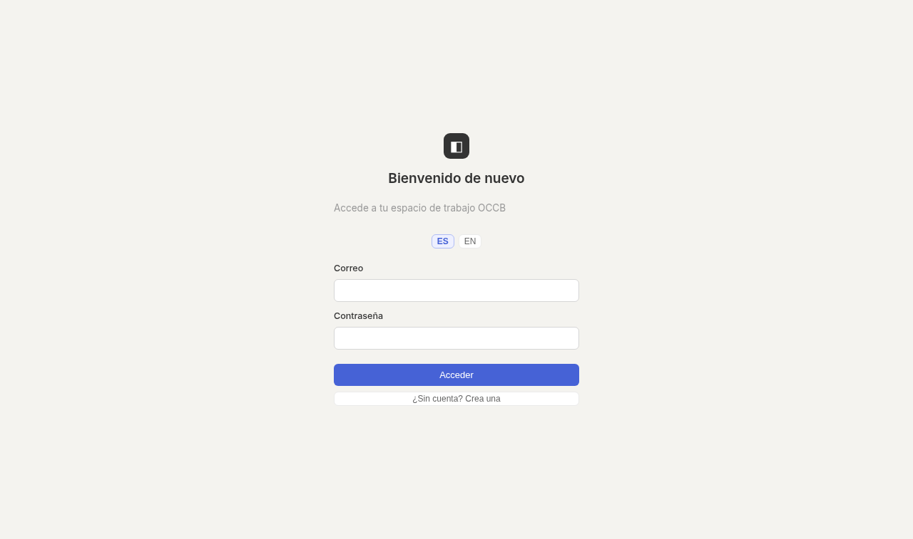

Roles: **admin** (gestiona miembros, roles y anonimización) y **miembro**.
Para cerrar sesión usa *Cerrar sesión* en la barra lateral.

## 2. Panel

Resumen vivo del espacio: valor en tubería, ganados, colegios y salud de la
tubería, más colegios recientes. El punto `● API :3001` indica datos vivos.

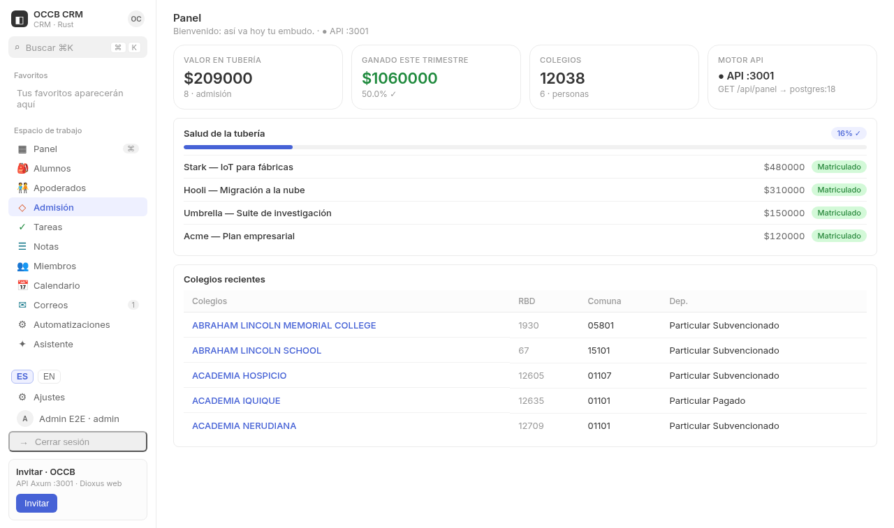

## 3. Alumnos

Tabla con búsqueda, filtro por estado y alta con RUT chileno validado
(dígito verificador). Los `☐` seleccionan filas: la cabecera marca todo lo
visible y la barra permite **Deshabilitar** en masa. Nada se borra de verdad
(ver §14).

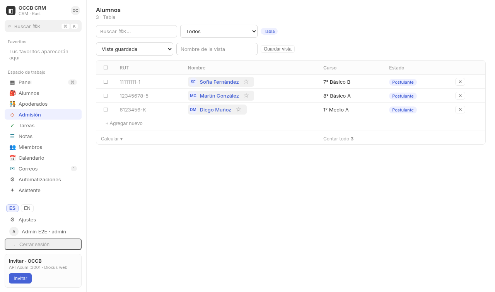

### Ficha del alumno

Desde el nombre se abre la ficha lateral: datos generales (editables con ✎),
**Salud** (grupo sanguíneo, alergias, medicamentos, antecedentes y contacto
de emergencia), **Ingresos médicos** (historial 1:N con alta y baja),
apoderados vinculados, traslados, tareas, notas, eventos, correos y
actividad reciente con su autor.

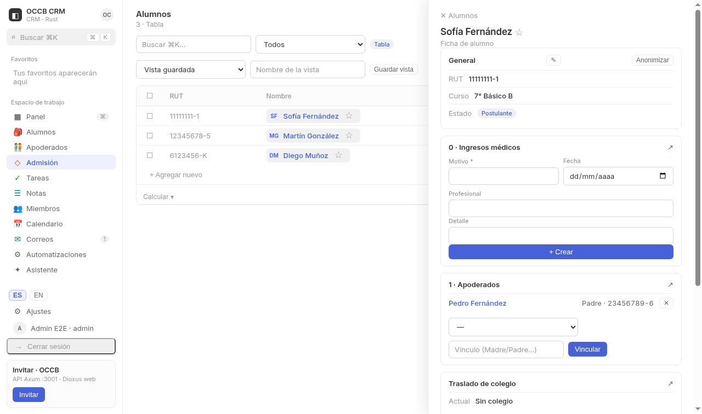

## 4. Apoderados

Como Alumnos pero con teléfono, ocupación y territorio (Región → Comuna).
La ficha muestra sus alumnos vinculados y su actividad.

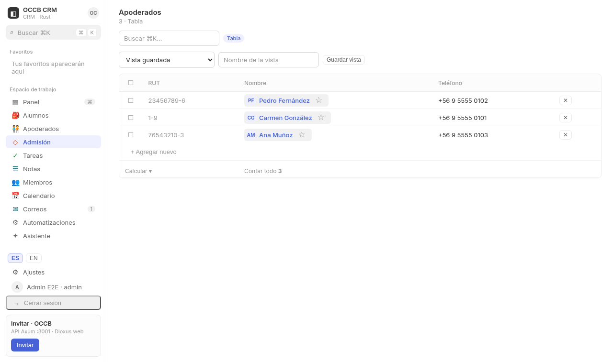

## 5. Admisión (embudo)

Kanban Contacto → Postulante → Evaluado → Aceptado → Matriculado. El `▶`
avanza de etapa y persiste; también hay vista tabla. Cada tarjeta abre su
ficha de postulación.

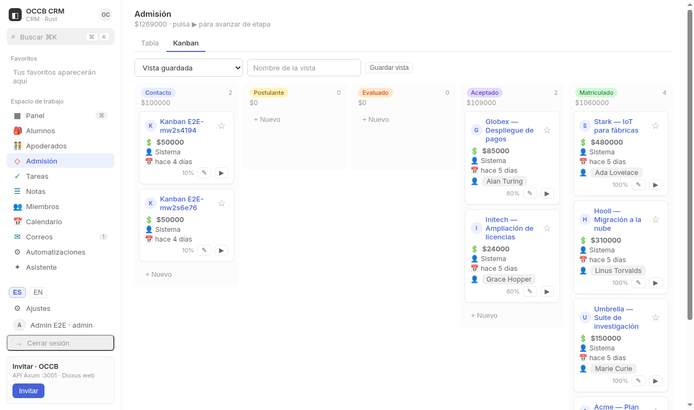

## 6. Tareas y 7. Notas

Tareas con estado y prioridad (▶ avanza, ✎ edita inline, ✕ deshabilita) y
notas con búsqueda de texto y edición inline. Ambas se vinculan a alumnos,
apoderados o postulaciones y aparecen en sus fichas.

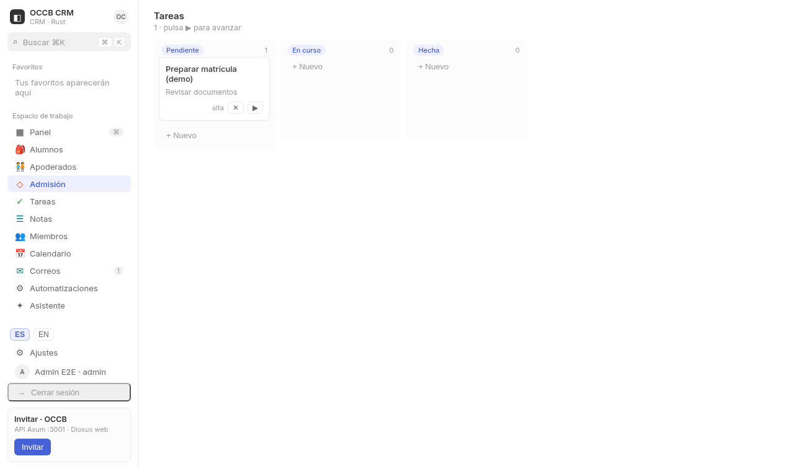

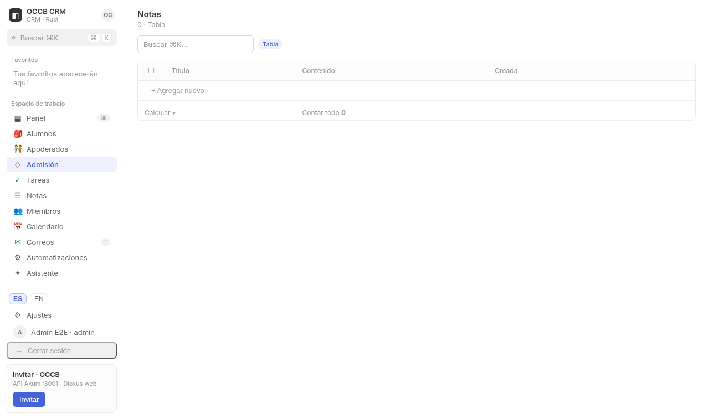

## 8. Calendario

Rejilla mensual (lunes primero): puntos en días con eventos, día seleccionado
con su lista, alta/edición/baja con fecha, lugar y vínculos. Las horas se
guardan y muestran en UTC.

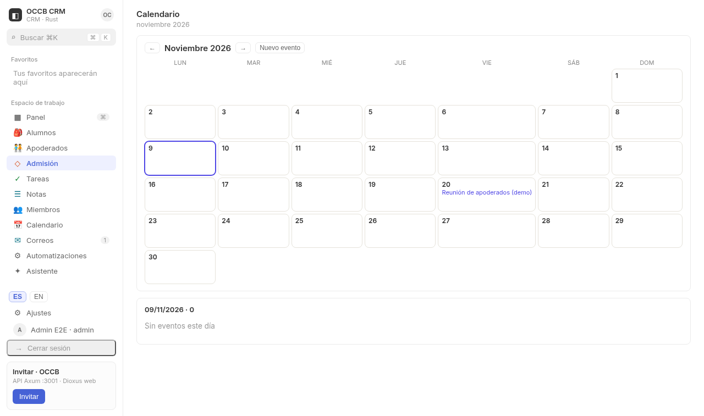

## 9. Correos

Bandeja vinculada: filtro de no leídos (con contador en el menú), lector que
marca leído al abrir, redacción con remitente y vínculos. Abrir un correo lo
marca leído en la base de datos.

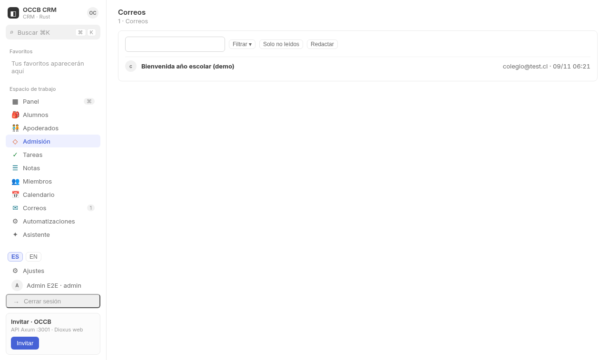

## 10. Miembros

Lista del espacio. Un admin puede promover o degradar roles; un miembro no ve
esos botones (recibe 403 si lo intenta por API).

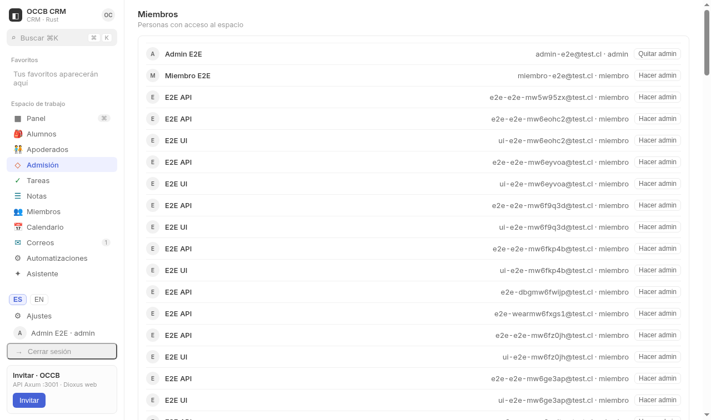

## 11. Automatizaciones

Reglas guiadas sobre postulaciones: disparador (al crear/actualizar) +
condición (igual/contiene/mayor que) + acción (crear tarea, crear nota o
mover etapa). Se pueden activar, desactivar y ver su historial de ejecuciones;
si una regla falla, queda registrada sin romper la operación original.

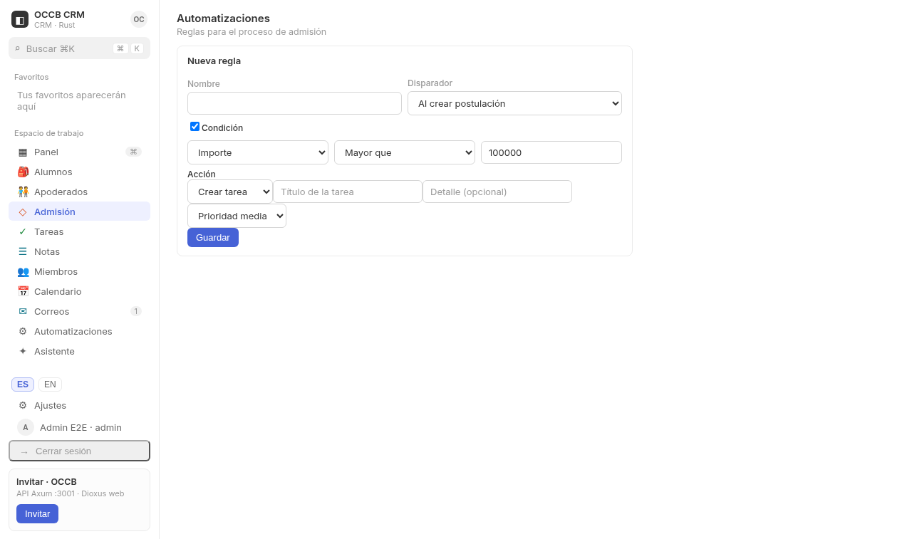

## 12. Asistente (chat)

Conversaciones personales con el asistente: pregunta por registros, pide el
resumen del panel o que cree notas/tareas, con fuentes enlazadas. Sin
proveedor configurado avisa y el resto sigue funcionando.

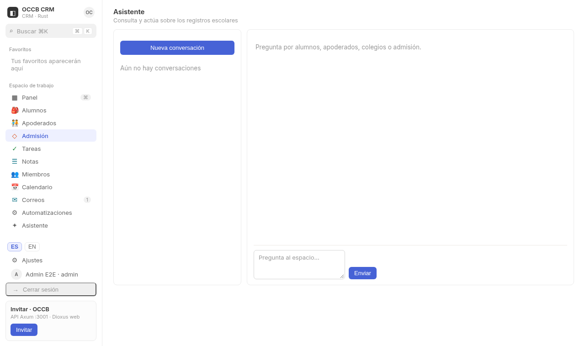

## 13. Ajustes: claves, webhooks e importación

- **Nombre del espacio**: Guardar lo aplica en la marca lateral.
- **Claves API**: se muestran una sola vez al crearlas; sirven para integrar
  terceros con los permisos del dueño y se revocan (401 desde entonces).
- **Webhooks**: URL https (http solo local), eventos, secreto de firma,
  prueba y entregas con reintentos.
- **Importar CSV**: pega o sube alumnos/apoderados, previsualiza con errores
  por fila e importa solo las válidas.

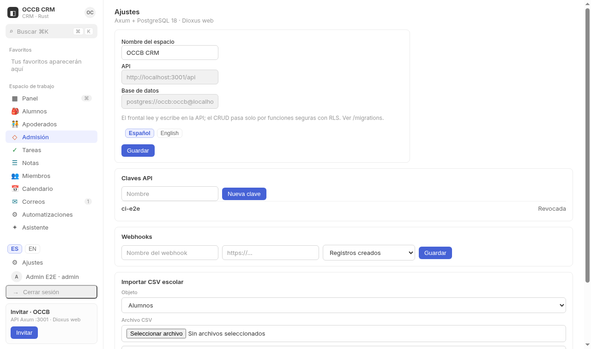

## 14. Búsqueda, favoritos, vistas y protección de datos

- **⌘K / Ctrl+K**: búsqueda global agrupada por tipo; Enter abre el primero.
- **★**: favoritos personales en listas y fichas, vivos en la barra lateral.
- **Vistas guardadas**: guardan filtros por lista y se reaplican.
- **Timeline**: cada ficha muestra altas/cambios con autor y fecha.
- **Nada se borra**: Deshabilitar oculta sin borrar (el RUT/correo se puede
  reutilizar); **Anonimizar** (solo admin, en dos pasos) reemplaza los datos
  personales por valores por defecto. Los UUID se conservan, así que informes
  e historial siguen consistentes.

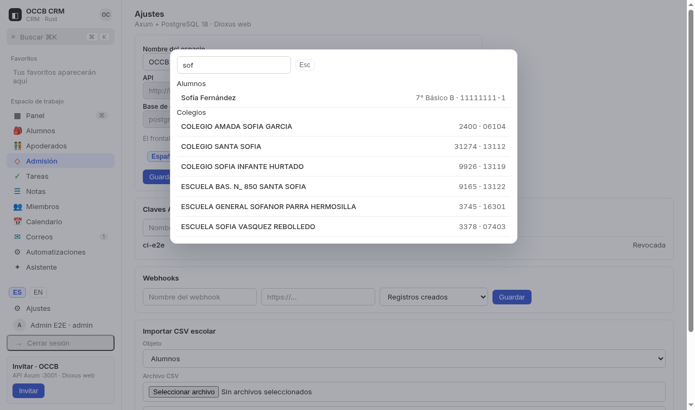
